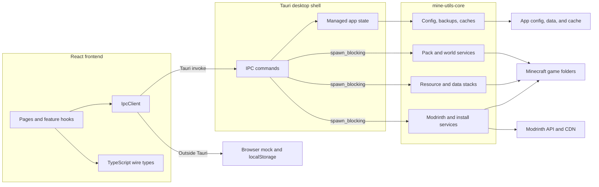
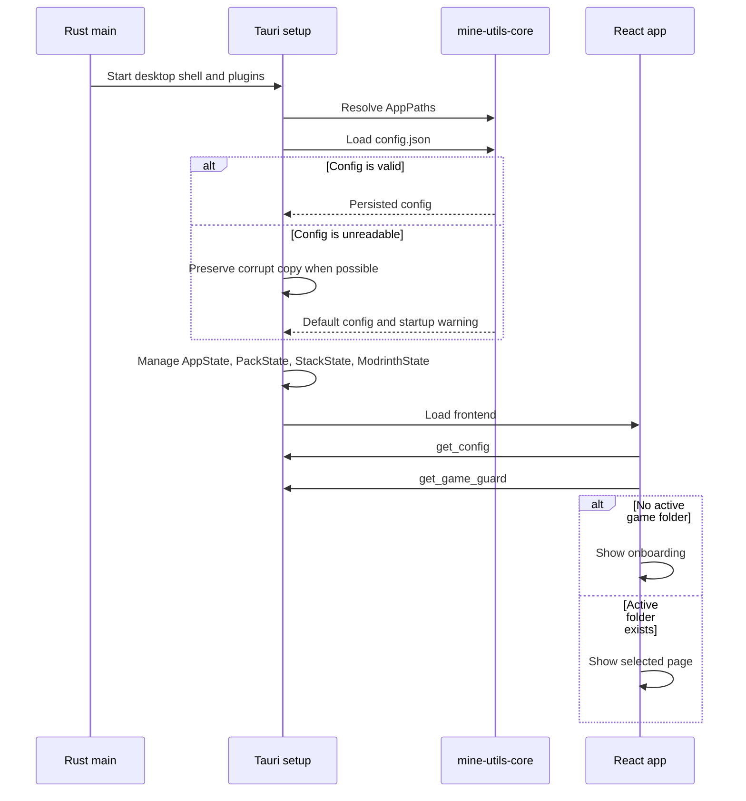
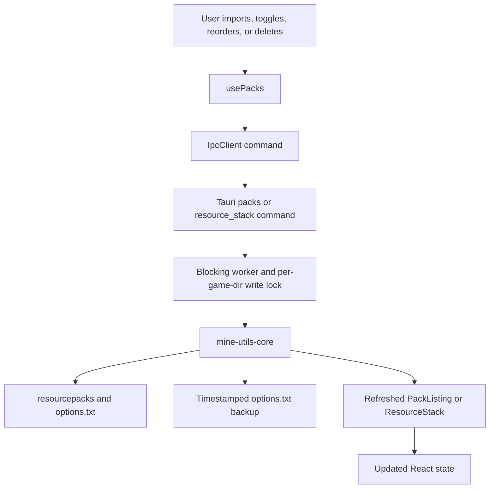
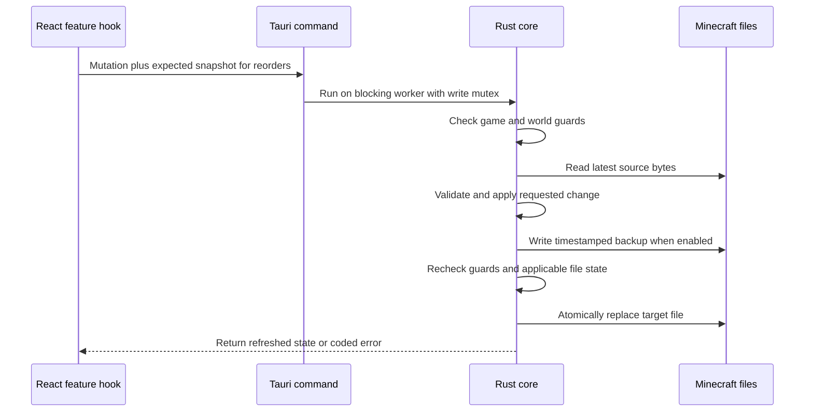
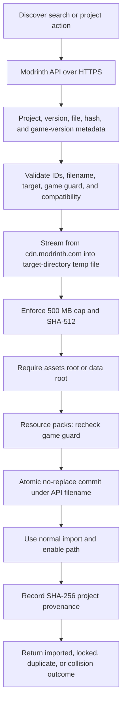

# Mine Utils architecture

This document describes how the app is structured and where its safety rules live. It is intended for contributors and anyone who wants to understand what Mine Utils changes on disk.

## Design goals

1. **Minecraft files remain the source of truth.** Mine Utils scans the active game folder instead of maintaining a separate pack database.
2. **The Rust core owns disk and network invariants.** The frontend can disable controls, but the backend still validates every operation.
3. **The Tauri layer stays thin.** Commands translate IPC requests into core calls and move blocking work off the UI thread.
4. **The frontend has one transport interface.** The same React UI runs against Tauri in production and a local mock in a browser.
5. **Local features stay local.** Only Discover uses the network.

## System overview

## Repository map

| Path | Responsibility |
| --- | --- |
| `src/main.tsx` | React bootstrap |
| `src/App.tsx` | Navigation, config loading, onboarding, theme application, game-guard polling, and refresh after Discover installs |
| `src/features/packs/` | Resource pack listing, import, details, active stack, and load-order UI |
| `src/features/worlds/` | World selection, datapack management, and compatibility display |
| `src/features/discover/` | Modrinth search, project details, version selection, and install flow |
| `src/features/settings/` | Theme and backup UI |
| `src/features/game-dirs/` | Game folder selection and registration |
| `src/features/onboarding/` | First-run folder selection |
| `src/lib/ipc.ts` | `IpcClient`, Tauri commands, runtime selection, and wire conversions |
| `src/lib/ipc.mock.ts` | Offline browser implementation with synthetic data |
| `src/lib/types.ts` | TypeScript counterparts of the Rust request and response shapes |
| `src-tauri/src/lib.rs` | Desktop setup, plugins, managed state, and command registration |
| `src-tauri/src/commands/` | Tauri adapters for game folders, the game guard, packs, stacks, worlds, and Discover |
| `crates/mine-utils-core/src/` | Filesystem, Minecraft formats, backups, locking, Modrinth, and install logic |
| `crates/mine-utils-core/src/bin/mine-utils-probe.rs` | CLI access to selected core operations |
| `assets/` | Project artwork |
| `.github/workflows/` | CI and release automation |

There is no global frontend store or router dependency. `App.tsx` owns app-level state, URL hashes identify pages, and feature hooks own server-backed state.

## Frontend

### App shell

`App.tsx` performs a small set of cross-feature jobs:

- Loads `Config` before deciding whether to show onboarding.
- Applies `system`, `light`, or `dark` to the document and follows system theme changes when needed.
- Polls `get_game_guard` every five seconds for the shared game-running state. The command only probes session locks and processes, so a missing or malformed `options.txt` cannot pause writes.
- Checks at once when the active folder changes or onboarding finishes. A folder change pauses writes until that folder's answer lands, even while the window is hidden and no check goes out. Until then the banner shows a neutral "Checking whether Minecraft is running" line instead of the "Game guard unavailable" alert, unless the last answer said Minecraft was running, in which case the banner keeps showing that running alert. Before the app's first answer, Settings disables Restore and Discover disables installs with the same checking reason.
- Skips a poll tick while the window is hidden. The window becoming visible triggers a check.
- Keeps at most one `get_game_guard` call outstanding across the whole app, because a call that hangs on a dead mount parks a backend thread. App is the only caller; pages, Settings included, read its answer. A tick, a Recheck, a visibility change, a folder change, or finished onboarding that finds a call outstanding is remembered, and one fresh check runs as soon as that call settles.
- Gives each check 15 seconds, three poll intervals. A check with no answer by then counts as failed and its late answer is ignored, but the slot stays busy until the call settles. A folder change that finds the slot busy drops that call's answer, even if the user switches back before it lands, so only a check sent after the change can answer. It also restarts the 15 seconds, hidden window or not, so the banner moves from checking to the unavailable alert instead of checking forever. Unmounting App clears the deadline and drops the outstanding answer and any remembered check.
- Treats `no_active_game_dir` as nothing to guard. Keeps writes paused and shows the unavailable alert when any other guard check fails or times out. Only a successful check can clear that state.
- Keeps visited pages mounted across navigation. After a Discover install, Packs and Worlds reload their data when visible without resetting page state.

### Feature state

`usePacks`, `useWorlds`, and `useModrinth` coordinate asynchronous operations and expose narrow state to their pages.

- Pack and stack failures are kept separate so one failed read does not erase the other view.
- Existing rows stay visible during later refreshes instead of being replaced by spinners.
- Request tokens prevent late Modrinth responses from replacing newer search or detail state.
- Reorder requests include the stack snapshot that the UI rendered.
- Resource stack dragging uses `dnd-kit`. Datapacks use explicit up and down controls.

### IPC boundary

`src/lib/ipc.ts` is the only client the pages call. At runtime it selects one of two implementations:

| Implementation | When it runs | Behavior |
| --- | --- | --- |
| `tauriClient` | Inside the desktop WebView | Calls registered Rust commands with Tauri `invoke` |
| `mockClient` | In a normal browser | Uses synthetic state and localStorage, with no disk or network access |

The module also converts cache paths to scoped `asset://` URLs and normalizes backend errors into `IpcError` values with `code` and `message` fields.

The browser mock is a UI development aid, not a safety reference. The Rust backend remains responsible for real validation, snapshots, locking, and persistence.

## Desktop shell and startup

`src-tauri/src/lib.rs` configures single-instance behavior, logging, saved window state, and native file dialogs.

The webview runs under the Content Security Policy in `src-tauri/tauri.conf.json`. It allows bundled code, inline styles, Tauri IPC, Modrinth CDN images, `data:` images, and cached `asset://` icons, and blocks every other origin. The capability grants only `dialog:allow-open` from the dialog plugin. `src-tauri/tests/security_config.rs` fails if the policy loses `default-src 'self'` or if an opener or `dialog:default` permission comes back.

Managed state has distinct roles:

- `AppState` owns the persisted `ConfigStore`, active paths, data directory, and startup warning.
- `PackState` shares the icon cache and in-memory pack hash cache.
- `StackState` holds one write mutex per canonical game directory.
- `ModrinthState` shares one HTTP client and connection pool.

## Core domain

The `mine-utils-core` crate does not depend on Tauri. This keeps filesystem and network policy testable without a desktop runtime.

| Module | Main responsibility |
| --- | --- |
| `game_dir.rs` | Detect and merge standard, Flatpak, Prism Launcher, MultiMC, and stored game folders |
| `config.rs` | Validate, persist, and mutate app configuration |
| `paths.rs` | Resolve platform config, data, and cache directories |
| `pack_scan.rs`, `pack.rs`, `pack_meta.rs` | Scan zip and folder packs, read `pack.mcmeta`, classify content, and expose metadata |
| `pack_source.rs` | Shared zip and folder entry listing, capped reads, fingerprints, and digests |
| `pack_import.rs` | Plan duplicate and collision outcomes, stage imports, recheck guards, and commit without replacement |
| `icon_cache.rs` | Cache local pack and world icons by content hash |
| `world.rs` | Scan saves, read world metadata, and report world state |
| `options_txt.rs` | Parse and atomically update resource pack arrays while preserving unrelated options |
| `level_dat.rs` | Read and atomically update the NBT data that owns datapack lists |
| `resource_stack.rs` | Enable, disable, reorder, delete, and back up resource stack state |
| `data_stack.rs` | Apply equivalent stack rules to world datapacks |
| `backup.rs`, `level_backup.rs` | Timestamp, list, rotate, and restore backups |
| `game_lock.rs` | Probe session locks and processes before writes |
| `modrinth.rs` | Search, project, version, URL, redirect, and retry policy |
| `download.rs` | Stream capped downloads, verify hashes and zip roots, and commit without replacement |
| `fs_commit.rs` | No-replace commit shared by downloads and pack imports |
| `install.rs` | Coordinate verified Modrinth downloads with import, enable, and provenance steps |
| `provenance.rs` | Record the Modrinth project and version associated with installed content |
| `error.rs` | Shared serializable application errors |

## Resource pack data flow

Scanning reads each pack and its metadata through `PackSource`. Folder sources reject root and nested symlinks during scanning, hashing, and import. Zip entries stay archive bytes and are never resolved as filesystem links. Both source types enforce metadata and icon limits on bytes actually read, and zip lookups normalize leading `./`. Enabling adds a `file/` entry to `resourcePacks`. Disabling removes that entry and any matching `incompatibleResourcePacks` entry. Unrelated `options.txt` lines stay intact.

Both stored stacks use load order from low to high. The UI reverses that list so the top card loads last and has the highest priority. Foreign entries such as `vanilla` keep their indices and cannot move.

For reorders, the expected snapshot prevents a request based on an old file set from silently replacing a newer stack. The backend validates filenames, entry multiplicities, locked positions, and the requested order.

## World datapack data flow

World selection determines a `WorldPaths` or `DataPaths` context. The backend combines three inputs:

1. Pack files under `saves/<world>/datapacks`
2. Enabled and disabled arrays under `Data.DataPacks` in `level.dat`
3. Game and world lock state

The UI merges these inputs into rows. This lets it show enabled entries, disabled entries, missing references, and files that exist on disk but are absent from `level.dat`.

Writes reject symlinked `level.dat` or `datapacks` targets. Datapack updates check both the game-wide guard and the selected world's own lock. Deletion moves the pack into `Disabled` before moving it to the system trash, then removes the reference once the trash succeeds. Once the pack is in `Disabled`, a failure of the guard check before the trash, or of the trash itself, leaves it installed and disabled, so Minecraft does not enable it again as a newly found pack. Only the first of these `level.dat` writes takes a backup, so the newest backup is the file from before the delete. A missing reference can be removed without requiring the file to exist.

## Write safety model

The UI mirrors backend state, but it is not the enforcement boundary.

Important properties:

- Reads remain available while the game runs. Writes are refused.
- Resource stack writes and options restores refuse a symlinked `options.txt`; stack reads remain available.
- The game guard checks held `session.lock` files and processes associated with the game directory.
- Stale lock files do not block writes. Unsupported lock probing is reported instead of being presented as successful detection.
- Stack mutations serialize through a per-game-directory mutex.
- Resource pack imports take the same mutex and check the game guard before each filesystem commit or trash operation. A replacement with a new filename rewrites both resource pack reference lists through the stack commit, preserving indices and backups.
- Both pack importers rename the old pack to `.mine-utils-replace-<original-name>.<pid>-<stamp>-<counter>.tmp` beside it, commit the new copy without replacement, update the stack, then trash the original. When its original name is free, the holding entry is renamed back without replacement before trashing. The scanner and duplicate search skip these hidden `.tmp` entries, and import rejects them as sources. A crash can leave one behind for manual recovery. A failure restores the original name without replacement and reports whether the new pack was installed; if that name is occupied, the error names the holding path. A duplicate plus a separate filename collision leaves both installed packs untouched.
- `options.txt`, `level.dat`, and `config.json` use temporary files, flush, and rename for replacement.
- Backups are enabled by default with a retention count of 10. Rotation is scoped to the options backups or the individual world's level backups.
- Restores back up the current file before replacing it and can recreate a missing target. A world backup with a different readable seed from the current world is refused without changing anything. A missing or corrupt current file, or an unreadable seed, still permits restore.
- A locked datapack world is the narrow import exception. The file can be copied, but enablement is deferred until the lock releases.

## Modrinth install pipeline

The install has two phases:

1. **Prepare** validates the target, checks guards, fetches metadata, and downloads or reuses verified bytes. It holds no stack write lock during network work.
2. **Finish** rechecks the source and target, rechecks the game guard for resource packs (a game started during the download refuses before anything is committed), commits the file, routes it through normal import behavior, and records provenance.

Cancellation shares one install ID between the frontend and the Tauri registry. The core checks an `InstallControl` before consuming each chunk and after validation. A bounded channel separates blocking network reads from the caller that owns the temporary file, so a blocked read cannot delay caller cancellation or the total preparation deadline. The network worker owns no file and exits when its current transport operation returns or its next channel send detects the dropped receiver. A process-wide permit limits live network readers to eight, including cancelled readers still blocked in transport. Waiting for a permit checks cancellation and consumes the same total deadline.

The commit point is the atomic transition from downloading to committing at the start of Finish, under the game-directory write lock. Cancellation before that transition deletes the verified temp. Cancellation after it returns false and Finish completes without further cancellation checks. The sheet then disables Cancel and explains that installation has started and will finish. Unmounting Discover or changing game folders requests cancellation; switching tabs retains the mounted page and its visible outcome.

The Tauri registry holds at most 64 installations. Cancelling a registered install that has not started removes it immediately. Ready entries expire at their preparation deadline and are pruned on registration or cancellation; running entries remain until their owner finishes.

Transport and validation rules include:

- Only Discover initiates requests. Local pages do not share this code path.
- Search requests return one page of 20 results and a `has_more` flag. Discover appends the next page only when the user selects **Load more**; a fresh search starts at offset 0, and a short or empty page ends pagination. Changing the query, project type, game version, or sort starts a fresh page. Nothing prefetches on scroll or in the background.
- Redirects are constrained to approved Modrinth hosts. The final download must use `https://cdn.modrinth.com` on the default port.
- The expected SHA-512 is required and checked while streaming. SHA-256 is also calculated for provenance.
- Resource packs require an `assets/` zip root. Datapacks require a `data/` root and a `.zip` filename.
- Datapack versions are checked against the target world version when the metadata declares versions.
- Invalid hashes, non-zip files, and wrong roots are not retried. HTTP 429 and 5xx responses can be retried up to three times while respecting `Retry-After`.
- Uncommitted temporary files are deleted on failure. On Unix, each download holds an advisory lock on its temp through commit or cleanup when locking is supported. Unsupported lock operations do not block downloads; other lock errors return `download_io` and clean up the temp.
- Before a new download, the temp sweep runs only on known local filesystems. Linux allows ext2/3/4, btrfs, XFS, F2FS, tmpfs, and ramfs after a successful `statfs`; macOS requires `MNT_LOCAL`. Network filesystems, FUSE mounts including SSHFS, unknown Linux filesystem types, failed probes, and other platforms skip the sweep because locks may protect only one mount or machine. On eligible filesystems, matching regular temps from other PIDs are removed only if their nonblocking exclusive lock succeeds and their mtime is more than one hour old. Current-PID temps, symlinks, and files that cannot be checked are kept.
- A provenance write warning is returned without rolling back an otherwise successful install.

## Persistence and file ownership

On a typical Linux setup, `directories::ProjectDirs` resolves these locations:

| Data | Default location | Owner and purpose |
| --- | --- | --- |
| App config | `~/.config/mine-utils/config.json` | Mine Utils schema, known folders, active folder, last world, theme, and backup policy |
| Backups | Under `~/.local/share/mine-utils/` | Timestamped `options.txt` and per-world `level.dat` copies, partitioned by a stable hash of the game path |
| Provenance | `~/.local/share/mine-utils/provenance.json` | Map from installed content hashes to Modrinth source metadata |
| Icon cache | Under `~/.cache/mine-utils/icons/` | Content-addressed local icons exposed through a scoped Tauri asset protocol |
| Resource packs | `<game-dir>/resourcepacks/` | Minecraft content scanned and copied by Mine Utils |
| Resource stack | `<game-dir>/options.txt` | Minecraft's resource pack and incompatible-pack arrays |
| Datapacks | `<game-dir>/saves/<world>/datapacks/` | World-specific content |
| Datapack stack | `<game-dir>/saves/<world>/level.dat` | Minecraft's enabled and disabled datapack arrays |

Config commits write the new file before updating the in-memory `ConfigStore`. A failed write therefore cannot leave memory ahead of disk. Startup preserves an unreadable config under a timestamped corrupt-backup name when possible and continues with defaults plus a visible warning.

## Error and concurrency model

Tauri commands accept frontend-friendly arguments, resolve the active paths, and delegate to `spawn_blocking`. Filesystem scans, NBT parsing, and blocking HTTP therefore do not occupy the WebView's UI thread.

Errors cross IPC as structured `AppError` values. The frontend normalizes them to `IpcError` and uses stable codes for behavior such as:

- `game_running` to refresh the guard
- `stale_stack` to reload changed stack state
- `no_active_game_dir` to show folder-selection guidance
- Modrinth offline codes to show the offline state

UI request tokens handle stale asynchronous responses. Backend snapshots, path validation, write locks, and repeated guard checks handle filesystem races. These are separate layers and one does not replace the other.

## Testing and delivery boundaries

| Layer | Tools | Main coverage |
| --- | --- | --- |
| React and TypeScript | Vitest, jsdom, Testing Library | Formatting, hooks, IPC behavior, dialogs, pack and world actions, onboarding, and settings |
| Rust core | Unit and integration tests | Minecraft format round trips, locking, backups, pack imports, downloads, and Modrinth installs |
| Tauri crate | Rust tests and build checks | Desktop command and shell compilation |
| CI | Separate frontend, Rust, and Tauri jobs | Lint, typecheck, tests, formatting, clippy, and a no-bundle Tauri build |
| Release | Tag-driven Linux workflow | AppImage, RPM, checksums, and GitHub release assets |

See [DEVELOPMENT.md](DEVELOPMENT.md) for the exact commands and release process.
